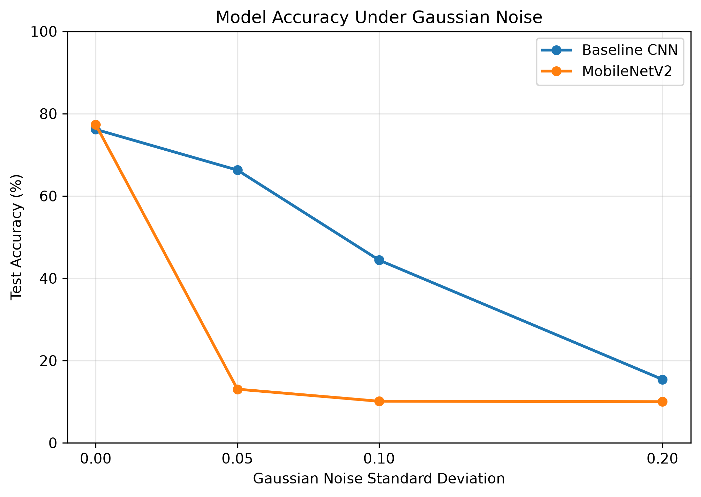
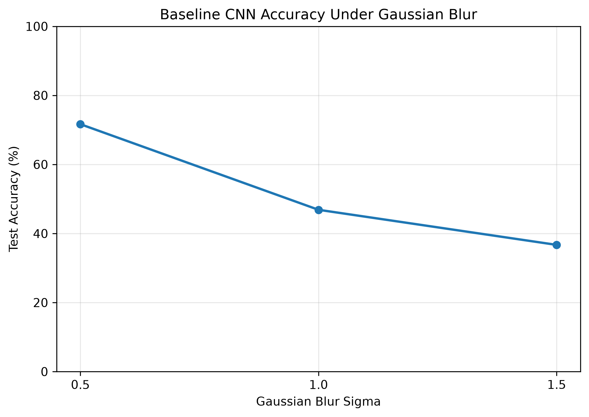
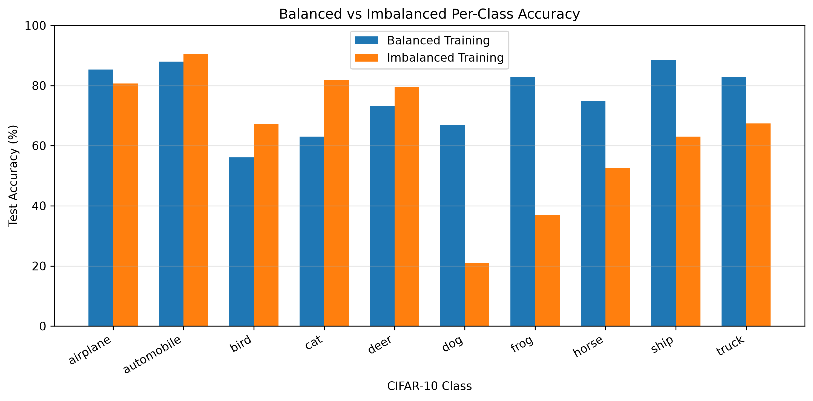
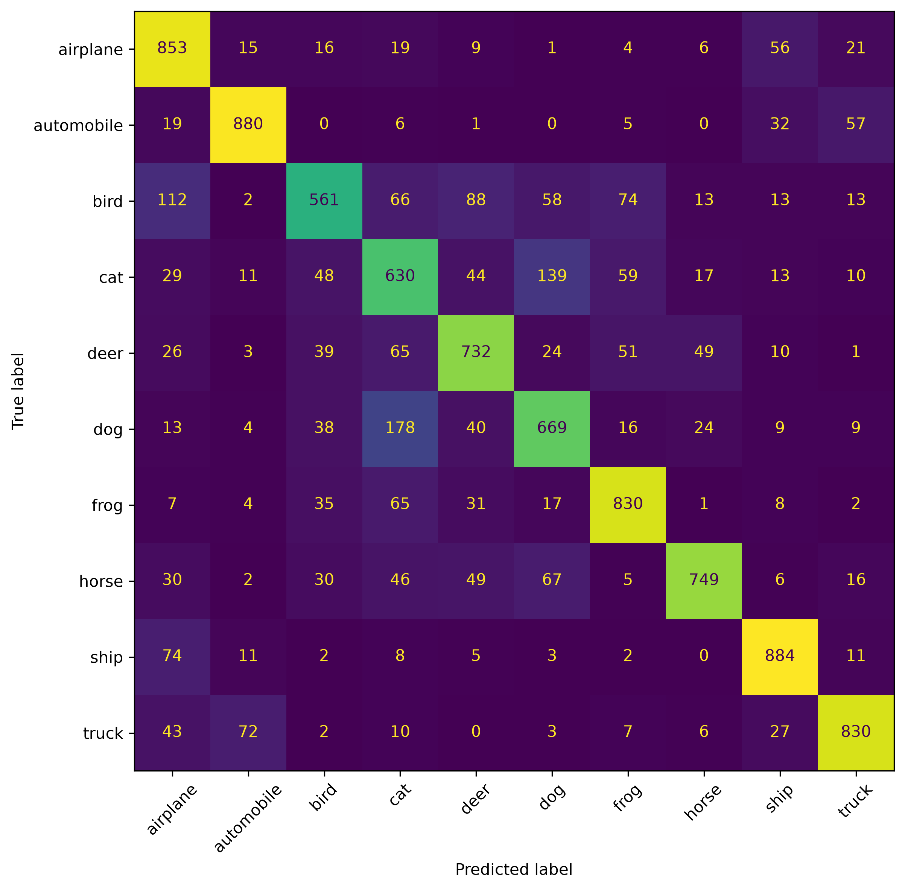
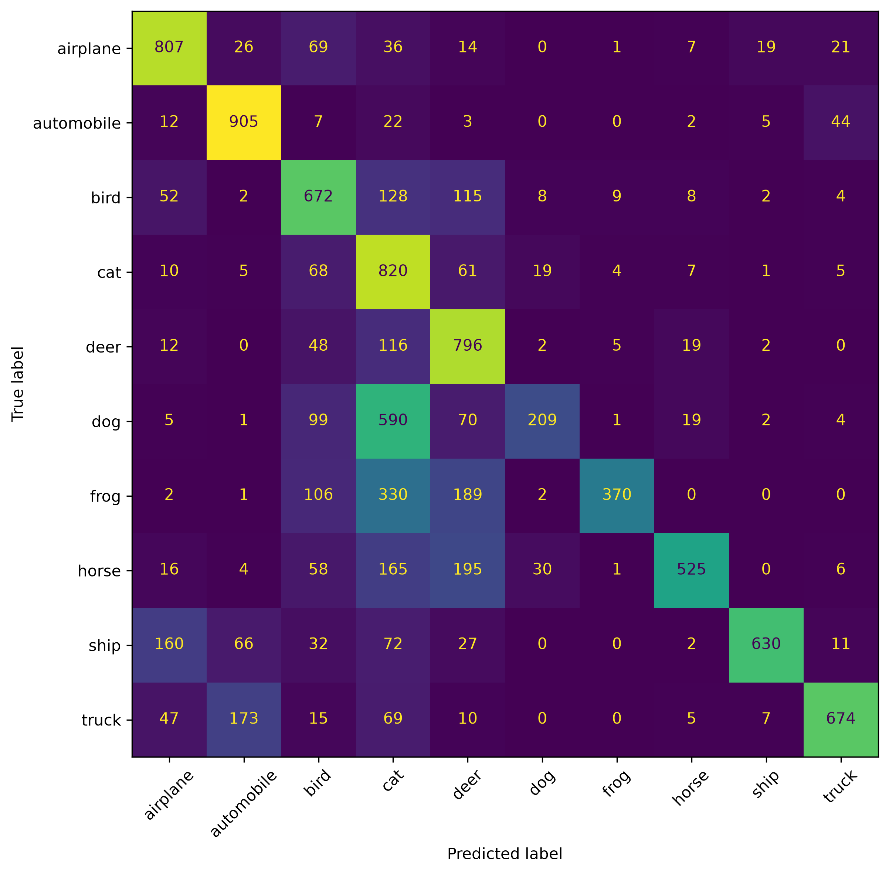

# CIFAR-10 Reliability Under Image Corruption and Class Imbalance

This project evaluates how reliable image classification models remain when test images are corrupted or when the training data is class-imbalanced.

## Dataset

We use the CIFAR-10 dataset, which contains 60,000 RGB images across 10 classes.

- 50,000 training images
- 10,000 test images
- 10 classes
- Image size: 32x32

## Models

Two models are evaluated:

- Baseline CNN trained from scratch
- MobileNetV2 using transfer learning

## Experiments

The project currently includes:

- Clean CIFAR-10 evaluation
- Gaussian noise corruption
- Gaussian blur corruption
- Class-imbalanced training
- Per-class accuracy analysis

## Current Results

### Clean Test Performance

| Model | Accuracy | Macro F1 |
|---|---:|---:|
| Baseline CNN | 76.18% | 0.7608 |
| MobileNetV2 | 77.34% | 0.7739 |
| Imbalanced CNN | 64.08% | 0.6377 |

### Gaussian Noise

| Noise Std | Baseline CNN | MobileNetV2 |
|---:|---:|---:|
| 0.00 | 76.18% | 77.34% |
| 0.05 | 66.29% | 13.05% |
| 0.10 | 44.41% | 10.12% |
| 0.20 | 15.42% | 10.01% |

The baseline CNN degraded gradually as Gaussian noise increased. MobileNetV2 achieved slightly better clean accuracy but was much more sensitive to Gaussian noise.

### Gaussian Blur - Baseline CNN

| Sigma | Accuracy |
|---:|---:|
| 0.5 | 71.65% |
| 1.0 | 46.86% |
| 1.5 | 36.70% |

The CNN accuracy decreased consistently as blur severity increased.

### Class Imbalance

For the imbalanced training experiment:

- Classes 0-4 retain 100% of their training samples.
- Classes 5-9 retain 20% of their training samples.

Overall test accuracy decreased from **76.18% to 64.08%**, while Macro F1 decreased from **0.7608 to 0.6377**.

| Class | Balanced CNN | Imbalanced CNN |
|---|---:|---:|
| airplane | 85.30% | 80.70% |
| automobile | 88.00% | 90.50% |
| bird | 56.10% | 67.20% |
| cat | 63.00% | 82.00% |
| deer | 73.20% | 79.60% |
| dog | 66.90% | 20.90% |
| frog | 83.00% | 37.00% |
| horse | 74.90% | 52.50% |
| ship | 88.40% | 63.00% |
| truck | 83.00% | 67.40% |

The largest drops were observed for dog, frog, horse, ship, and truck. Some classes improved despite the imbalance, showing that the effect of reducing training samples was not identical across all classes.

## Result Visualizations

### Gaussian Noise Robustness



### Gaussian Blur Robustness



### Balanced vs Imbalanced Per-Class Accuracy



### Balanced CNN Confusion Matrix



### Imbalanced CNN Confusion Matrix



## Main Findings

The experiments produced three main observations:

1. The baseline CNN and MobileNetV2 achieved similar performance on clean CIFAR-10 data, with MobileNetV2 achieving slightly higher accuracy and Macro F1.

2. Similar clean-data performance did not imply similar robustness. MobileNetV2 degraded much more severely than the baseline CNN under Gaussian noise.

3. Class-imbalanced training reduced both overall accuracy and Macro F1. The effect also varied substantially between individual classes.

These experiments show that clean test accuracy alone does not fully describe model reliability under corrupted or imbalanced data.

## Repository Structure

```text
.
├── src/
│   ├── data.py
│   ├── models.py
│   ├── train.py
│   ├── train_mobilenet.py
│   ├── train_imbalanced.py
│   ├── evaluate.py
│   ├── evaluate_corruption.py
│   └── plot_results.py
├── results/
│   ├── results.csv
│   ├── per_class_accuracy.csv
│   ├── noise_robustness.png
│   ├── blur_robustness.png
│   └── imbalanced_per_class_accuracy.png
├── notebooks/
├── requirements.txt
└── README.md
```

## Installation

```bash
pip install -r requirements.txt
```

## Training

Train the baseline CNN:

```bash
python src/train.py
```

Train MobileNetV2:

```bash
python src/train_mobilenet.py
```

Train on the imbalanced dataset:

```bash
python src/train_imbalanced.py
```

## Corruption Evaluation

Gaussian noise:

```bash
python src/evaluate_corruption.py --type noise --severity 0.1 --num-workers 2
```

Gaussian blur:

```bash
python src/evaluate_corruption.py --type blur --severity 1.0 --num-workers 2
```

## Visualization

Generate result plots:

```bash
python src/plot_results.py
```

## Key Observation

The experiments show that similar clean-data accuracy does not guarantee similar robustness. MobileNetV2 achieved slightly higher clean accuracy than the baseline CNN but degraded much more severely under Gaussian noise. Class imbalance also caused a noticeable decrease in overall accuracy and disproportionately affected minority classes.
